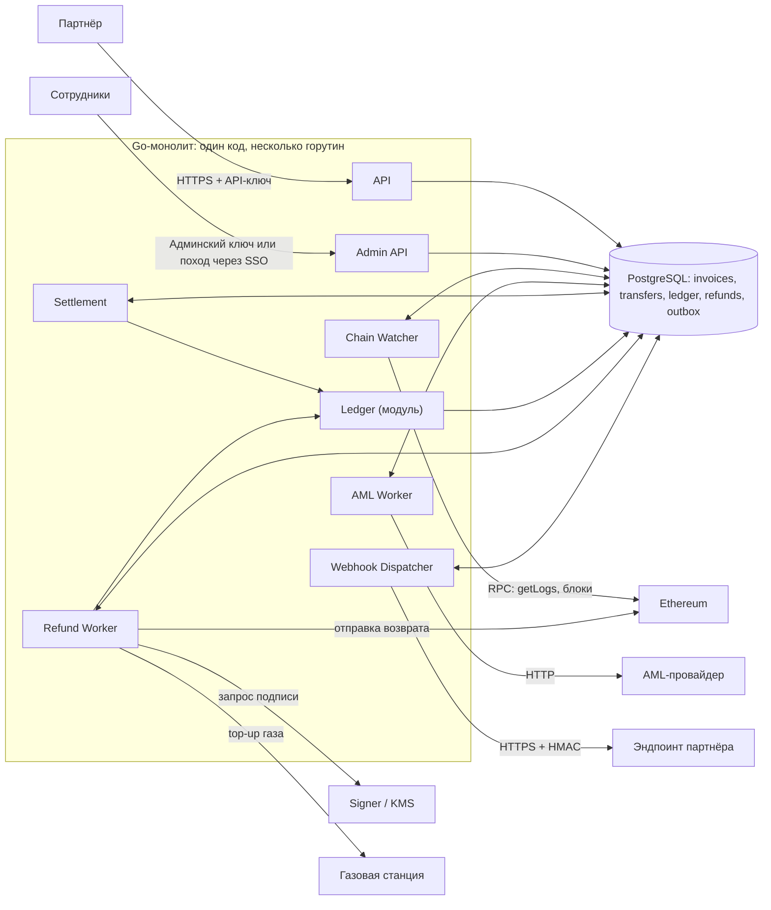

# Дизайн-документ

## 1. Архитектура

#### Компоненты системы и как они взаимодействуют: API, отслеживание входящих переводов, AML, ledger, возвраты, уведомления партнёров, админка.

Назначение:

- Партнёр — создаёт счета через API, проверяет их состояние и получает уведомления о платежах и возвратах.
- API — аутентифицирует партнёров, валидирует запросы, создаёт счета и возвращает статусы операций.
- Сотрудники — разбирают спорные платежи, контролируют AML-проверки, управляют возвратами, устанавливают комиссию.
- Admin API — предоставляет сотрудникам доступ к операциям с проверкой прав и аудитом действий.
- Go-монолит — объединяет API и фоновые обработчики в одном приложении; модули взаимодействуют через вызовы и данные в БД.
- Chain Watcher — отслеживает входящие переводы, сохраняет их в БД, учитывает подтверждения и реорганизации блокчейна.
- AML Worker — отправляет переводы на AML-проверку и сохраняет результаты для дальнейшего решения о зачислении или возврате.
- Settlement — сопоставляет переводы со счетами и после необходимых подтверждений и AML-проверки фиксирует зачисление (или возврат) через ledger. Тут же учитываются комиссии и тарифы.
- Ledger — ведёт финансовый учёт: записывает проводки зачислений, возвратов, обеспечивает согласованность балансов.
- Refund Worker — обрабатывает одобренные возвраты: резервирует средства через ledger, организует подпись и отправку транзакции, отслеживает её результат.
- Webhook Dispatcher — доставляет партнёрам события из outbox, подписывает уведомления HMAC и повторяет отправку при ошибках.
- PostgreSQL — хранит счета, переводы, проводки, возвраты и очередь уведомлений; обеспечивает атомарность связанных изменений. Единственный источник истинны.
- Ethereum — предоставляют события и блоки, принимают подписанные транзакции.
- AML-провайдер — оценивает риск перевода и возвращает результат проверки.
- Signer / KMS — защищает приватные ключи и подписывает разрешённые транзакции возврата.
- Газовая станция — пополняет ETH на адресах, которым нужен газ для отправки возврата.
- Эндпоинт партнёра — принимает webhook-уведомления и проверяет их подлинность по HMAC.

#### Как обнаруживаете входящие переводы USDT: сканирование блоков, подписка на события или внешний индексер. Что с подтверждениями и реоргами? Как не засчитать поддельный токен с названием «USDT» или перевод из неуспешной транзакции?

Выбрал сканирование блоков в силу низкой зависимости от внешних провайдеров, но при этом жертвуется техническая простота. Потенциально при больших потоках более дешевое решение (поддерживать свою ноду а не платить внешним). Можем восстанавливать чтение с определенного блока. 

- Для каждого блока храним номер и хеш.
- На каждом тике сравниваем хеш родителя нового блока с тем, что сохранили. Если не совпало, значит цепочка перестроилась.
- Находим общий блок-предок, откатываем курсор к нему и помечаем переводы из исчезнувших блоков как reorged.
- Пересканируем заново. Если перевод попал в новый блок, он вернётся в detected (в новом блоке и, возможно, с другим log_index). Если нет, остаётся reorged.
- Деньги двигаются только после N подтверждений и ответа AML. Поэтому откат до N подтверждений не оставляет «висящего» зачисления: проводок просто не было.

Если реорг всё же глубже N (практически невозможно при разумном N), это инцидент: алерт, ручной разбор, сторно в ledger.

Мы запрашиваем логи только у одного адреса контракта (настоящий USDT, зашит в конфиге) и дополнительно проверяем адрес источника в каждом полученном логе. Всё остальное мы даже не читаем.

проверяем receipt.status == 1 и совпадение блока для защиты от неуспешных транзакций.

#### Как выдаёте адреса для депозита и где храните ключи. Что сделали бы в проде?

Адреса: HD-кошелёк (BIP-32/44), бэкенд хранит только xpub и выводит адрес по порядковому номеру счёта (уникальные номер и адрес в БД, адреса не переиспользуются). Приватных ключей на серверах приложения нет. Ключи и подпись находятся в изолированном Signer (KMS), который принимает не готовую транзакцию, а идентификатор одобренной операции и проверяет её сам: статус, адрес назначения, лимиты; все подписи журналируются.

В проде: sweep депозитных адресов на холодный кошелёк

#### Как партнёр узнаёт о платеже: вебхуки, гарантии доставки, подпись.

доставка at-least-once через transactional outbox. Событие пишется в outbox в той же транзакции БД, что и смена статуса; отдельный диспетчер читает его (SKIP LOCKED), отправляет HTTPS-запрос и считает успехом 2xx. Ретраи с экспоненциальной задержкой и jitter до 72 часов, затем dead letter и ручная пересылка из админки. Дубли и порядок: у события есть event_id (для дедупликации) и возрастающий seq по счёту; события партнёра отправляются последовательно. Подпись: HMAC-SHA256(secret, timestamp + "." + body) в заголовке, окно валидности 5 минут. Суммы в теле строками.

#### Что сломается первым при росте до 1 млн счетов в день и что вы с этим сделаете?