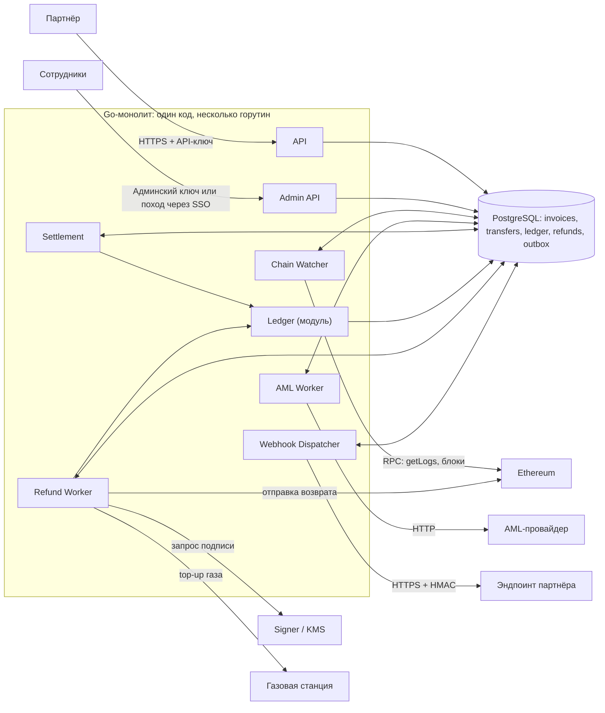

# Дизайн-документ

## 1. Архитектура

#### Компоненты системы и как они взаимодействуют: API, отслеживание входящих переводов, AML, ledger, возвраты, уведомления партнёров, админка.

Назначение:

- Партнёр — создаёт счета через API, проверяет их состояние и получает уведомления о платежах и возвратах.
- API — аутентифицирует партнёров, валидирует запросы, создаёт счета и возвращает статусы операций.
- Сотрудники — разбирают спорные платежи, контролируют AML-проверки, управляют возвратами, устанавливают комиссию.
- Admin API — предоставляет сотрудникам доступ к операциям с проверкой прав и аудитом действий.
- Go-монолит — объединяет API и фоновые обработчики в одном приложении; модули взаимодействуют через вызовы и данные в БД.
- Chain Watcher — отслеживает входящие переводы, сохраняет их в БД, учитывает подтверждения и реорганизации блокчейна.
- AML Worker — отправляет переводы на AML-проверку и сохраняет результаты для дальнейшего решения о зачислении или возврате.
- Settlement — сопоставляет переводы со счетами и после необходимых подтверждений и AML-проверки фиксирует зачисление (или возврат) через ledger. Тут же учитываются комиссии и тарифы.
- Ledger — ведёт финансовый учёт: записывает проводки зачислений, возвратов, обеспечивает согласованность балансов.
- Refund Worker — обрабатывает одобренные возвраты: резервирует средства через ledger, организует подпись и отправку транзакции, отслеживает её результат.
- Webhook Dispatcher — доставляет партнёрам события из outbox, подписывает уведомления HMAC и повторяет отправку при ошибках.
- PostgreSQL — хранит счета, переводы, проводки, возвраты и очередь уведомлений; обеспечивает атомарность связанных изменений. Единственный источник истинны.
- Ethereum — предоставляют события и блоки, принимают подписанные транзакции.
- AML-провайдер — оценивает риск перевода и возвращает результат проверки.
- Signer / KMS — защищает приватные ключи и подписывает разрешённые транзакции возврата.
- Газовая станция — пополняет ETH на адресах, которым нужен газ для отправки возврата.
- Эндпоинт партнёра — принимает webhook-уведомления и проверяет их подлинность по HMAC.