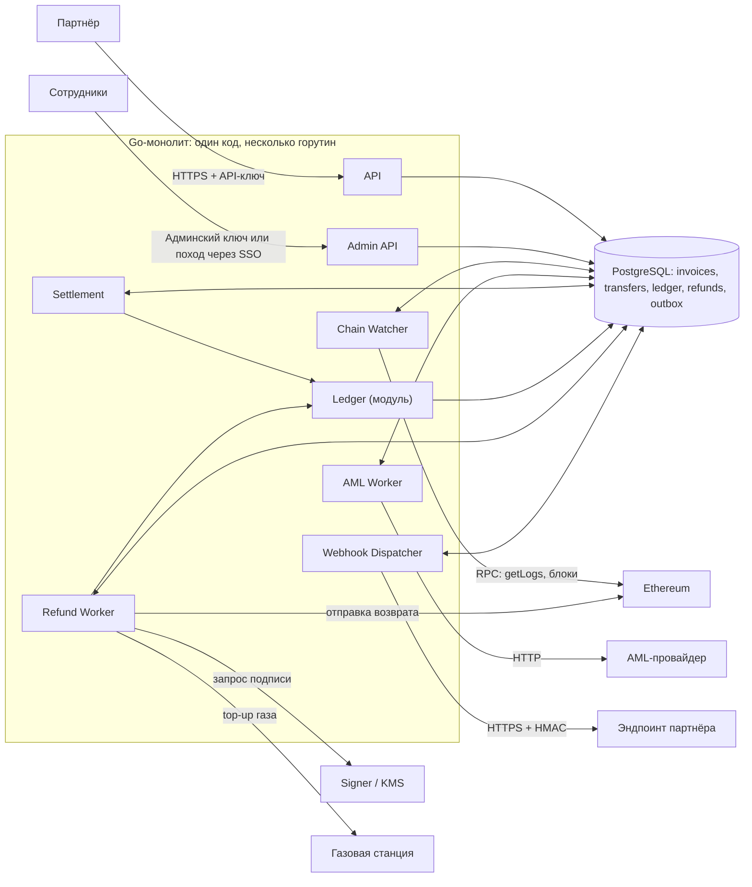
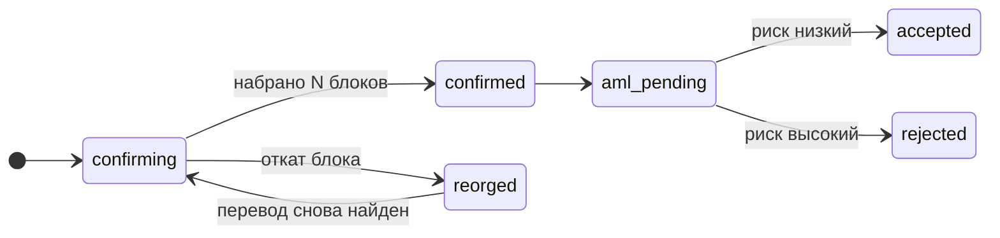
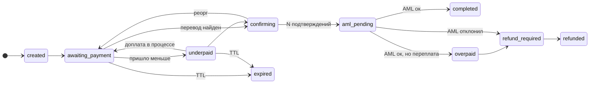
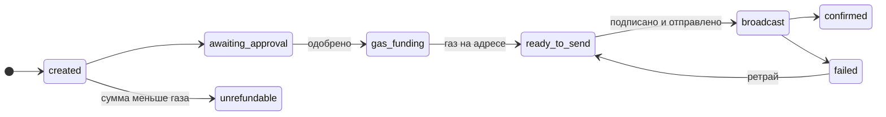

# Дизайн-документ

## 1. Архитектура

#### Компоненты системы и как они взаимодействуют: API, отслеживание входящих переводов, AML, ledger, возвраты, уведомления партнёров, админка.

Назначение:

- Партнёр — создаёт счета через API, проверяет их состояние и получает уведомления о платежах и возвратах.
- API — аутентифицирует партнёров, валидирует запросы, создаёт счета и возвращает статусы операций.
- Сотрудники — разбирают спорные платежи, контролируют AML-проверки, управляют возвратами, устанавливают комиссию.
- Admin API — предоставляет сотрудникам доступ к операциям с проверкой прав и аудитом действий.
- Go-монолит — объединяет API и фоновые обработчики в одном приложении; модули взаимодействуют через вызовы и данные в БД.
- Chain Watcher — отслеживает входящие переводы, сохраняет их в БД, учитывает подтверждения и реорганизации блокчейна.
- AML Worker — отправляет переводы на AML-проверку и сохраняет результаты для дальнейшего решения о зачислении или возврате.
- Settlement — сопоставляет переводы со счетами и после необходимых подтверждений и AML-проверки фиксирует зачисление (или возврат) через ledger. Тут же учитываются комиссии и тарифы.
- Ledger — ведёт финансовый учёт: записывает проводки зачислений, возвратов, обеспечивает согласованность балансов.
- Refund Worker — обрабатывает одобренные возвраты: резервирует средства через ledger, организует подпись и отправку транзакции, отслеживает её результат.
- Webhook Dispatcher — доставляет партнёрам события из outbox, подписывает уведомления HMAC и повторяет отправку при ошибках.
- PostgreSQL — хранит счета, переводы, проводки, возвраты и очередь уведомлений; обеспечивает атомарность связанных изменений. Единственный источник истинны.
- Ethereum — предоставляют события и блоки, принимают подписанные транзакции.
- AML-провайдер — оценивает риск перевода и возвращает результат проверки.
- Signer / KMS — защищает приватные ключи и подписывает разрешённые транзакции возврата.
- Газовая станция — пополняет ETH на адресах, которым нужен газ для отправки возврата.
- Эндпоинт партнёра — принимает webhook-уведомления и проверяет их подлинность по HMAC.

#### Как обнаруживаете входящие переводы USDT: сканирование блоков, подписка на события или внешний индексер. Что с подтверждениями и реоргами? Как не засчитать поддельный токен с названием «USDT» или перевод из неуспешной транзакции?

Выбрал сканирование блоков в силу низкой зависимости от внешних провайдеров, но при этом жертвуется техническая простота. Потенциально при больших потоках более дешевое решение (поддерживать свою ноду а не платить внешним). Можем восстанавливать чтение с определенного блока. 

- Для каждого блока храним номер и хеш.
- На каждом тике сравниваем хеш родителя нового блока с тем, что сохранили. Если не совпало, значит цепочка перестроилась.
- Находим общий блок-предок, откатываем курсор к нему и помечаем переводы из исчезнувших блоков как reorged.
- Пересканируем заново. Если перевод попал в новый блок, он вернётся в detected (в новом блоке и, возможно, с другим log_index). Если нет, остаётся reorged.
- Деньги двигаются только после N подтверждений и ответа AML. Поэтому откат до N подтверждений не оставляет «висящего» зачисления: проводок просто не было.

Если реорг всё же глубже N (практически невозможно при разумном N), это инцидент: алерт, ручной разбор, сторно в ledger.

Мы запрашиваем логи только у одного адреса контракта (настоящий USDT, зашит в конфиге) и дополнительно проверяем адрес источника в каждом полученном логе. Всё остальное мы даже не читаем.

проверяем receipt.status == 1 и совпадение блока для защиты от неуспешных транзакций.

#### Как выдаёте адреса для депозита и где храните ключи. Что сделали бы в проде?

Адреса: HD-кошелёк (BIP-32/44), бэкенд хранит только xpub и выводит адрес по порядковому номеру счёта (уникальные номер и адрес в БД, адреса не переиспользуются). Приватных ключей на серверах приложения нет. Ключи и подпись находятся в изолированном Signer (KMS), который принимает не готовую транзакцию, а идентификатор одобренной операции и проверяет её сам: статус, адрес назначения, лимиты; все подписи журналируются.

В проде: sweep депозитных адресов на холодный кошелёк

#### Как партнёр узнаёт о платеже: вебхуки, гарантии доставки, подпись.

доставка at-least-once через transactional outbox. Событие пишется в outbox в той же транзакции БД, что и смена статуса; отдельный диспетчер читает его (SKIP LOCKED), отправляет HTTPS-запрос и считает успехом 2xx. Ретраи с экспоненциальной задержкой и jitter до 72 часов, затем dead letter и ручная пересылка из админки. Дубли и порядок: у события есть event_id (для дедупликации) и возрастающий seq по счёту; события партнёра отправляются последовательно. Подпись: HMAC-SHA256(secret, timestamp + "." + body) в заголовке, окно валидности 5 минут. Суммы в теле строками.

#### Что сломается первым при росте до 1 млн счетов в день и что вы с этим сделаете?

Проблемным местом может стать газовая станция требующая пополнения ETH для осуществления возвратов. Рост количества депозитных адресов приводит к разрастанию индекса БД, при обращении к нему запросы чаще будут подгружать страницы из памяти, что может замедлить работу. 

Для газовой станции: пополнение с казначейского кошелька по заявке с лимитами и двойным одобрением. Автоматическое пополнение возможно, но только в пределах дневного лимита, иначе станция сама становится способом вывода денег. 

Для роста индекса: партиционирование по времени создания счёта: свежие партиции (где реально приходят платежи) помещаются в кэш, старые остаются на диске.

## 2. Деньги

### Перевод (transfers)

### Счёт (invoices)

Статус счёта выводится из статусов его переводов, потому что на один счёт может прийти несколько переводов.

### Возврат (refunds)

Газ для возврата. На депозитном адресе есть USDT, но нет ETH. В v1 используем газовую станцию: hot-кошелёк с запасом ETH отправляет на адрес возврата рассчитанную сумму (газ transfer USDT × текущая цена × 1,2), после подтверждения Signer подписывает возврат USDT.

Платит отправитель: стоимость газа в USDT-эквиваленте по курсу на момент top-up вычитается из суммы возврата (gas:advance в ledger), комиссию на возврат не берём. Если сумма возврата не больше стоимости газа (с настраиваемым порогом), возврат помечается unrefundable и уходит на решение ops.

## 3. Продуктовые вопросы

### 1. Недоплата на 3%.

- Клиент видит «получено 97 из 100 USDT, доплатите 3 USDT на тот же адрес», срок счёта продлевается, точная сумма и предупреждение о комиссии биржи показаны до оплаты.
- Партнёр получает вебхук invoice.underpaid с полями expected, received, remaining, товар не отдаёт до invoice.completed.
- Поддержка видит таймлайн всех переводов счёта и может вручную принять недоплату через manual_review с записью в аудит.
- Поведение настраивается параметром партнёра underpayment_policy: strict (ждём доплату, по истечении срока возврат), tolerance_bps (автоприём в пределах допуска, по умолчанию 0,5%) и accept_partial (по истечении срока зачисляем полученное, партнёр сам решает, отдавать ли товар).
- Комиссия считается с фактически полученной суммы.

### 2. AML отклонил платёж.

- За возврат платит отправитель: газ вычитается из суммы возврата, комиссию с возврата не берём.
- Если сумма не больше стоимости газа, возврат получает статус unrefundable, деньги остаются в холде, решение за ops.
- Если деньги пришли с биржи, автовозврата нет: запрашиваем у клиента адрес с подтверждением владения (статус awaiting_destination).
- Санкционные случаи не возвращаются вовсе: статус frozen, решение за compliance.

### 3. Комиссия

- Модель: процент плюс фиксированная часть с минимумом и максимумом на партнёра, тариф копируется в счёт при создании.
- В ledger комиссия отдельной проводкой в revenue:fees при зачислении, структура счетов не зависит от формулы.
- В отчётах партнёра по каждому платежу видны gross, fee и net отдельными колонками.

### 4. Метрики.

- Партнёр: конверсия счетов, объём gross, комиссия и net, баланс доступный и в холде, проблемные счета по причинам, доставка вебхуков.
- Админка: возраст старейшего aml_pending и доля ошибок AML, отставание watcher от головы сети, очередь возвратов с unrefundable, сверка ledger с остатками на адресах, остаток ETH газовой станции.

### 5. Две недели, два разработчика.

- Делаем: API со счетами и идемпотентностью, адреса из xpub, watcher с подтверждениями и реоргами, AML, ledger с зачислением и комиссией, underpaid с доплатой и политикой strict с допуском, возвраты до ready_to_send, вебхуки с подписью, минимальную админку и сверку.
- Откладываем: режим accept_partial (в схеме он есть, реализуем после первого релиза), автоотправку возвратов и газовую станцию, sweep, тарифные ступени, кабинет партнёра и мультичейн.
- Причина: главный риск продукта в деньгах и AML, поэтому сначала корректность, а редкие дорогие сценарии закрываем вручную с аудитом.

## 4. Журнал решений

1. Модульный монолит на Go и Postgres, очереди как таблицы (SKIP LOCKED) и transactional outbox. Отбросил микросервисы с Kafka из-за излишней сложности в начале.

2. Обнаружение переводов сканированием блоков (eth_getLogs по контракту USDT) с курсором в БД. Отбросил внешний индексер и WebSocket как источник истины: курсор и свои проверки реоргов дают полный контроль.

3. Газ для возврата платит отправитель: газовая станция авансирует ETH, стоимость вычитается из суммы возврата. Отбросил оплату газа сервисом: любая AML-атака превращается в прямой убыток.

4. Адреса по xpub, приватные ключи только в изолированном Signer (KMS), который подписывает по идентификатору одобренного возврата. Отбросил ключи в БД, зашифрованные приложением.

5. Недоплата: сначала решил убрать статус underpaid и обрабатывать каждый перевод независимо, потом вернул ожидание доплаты с политикой партнёра